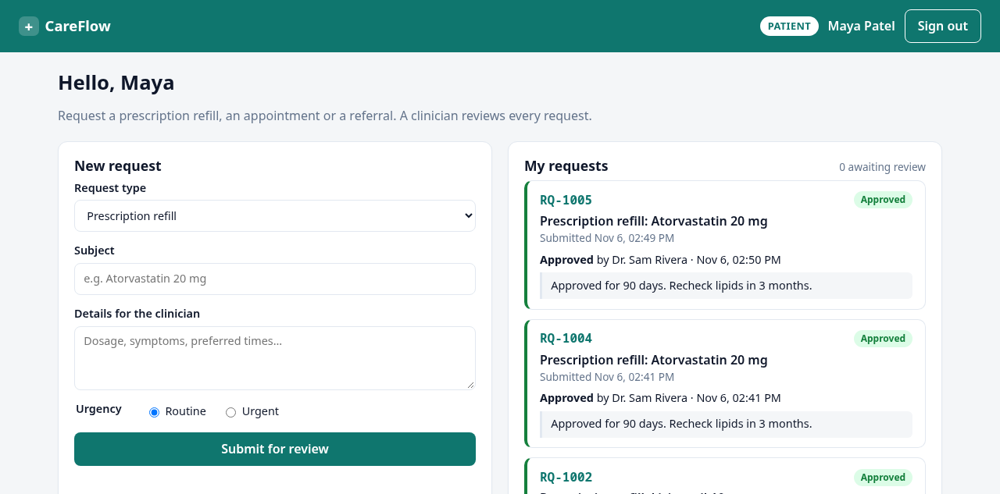
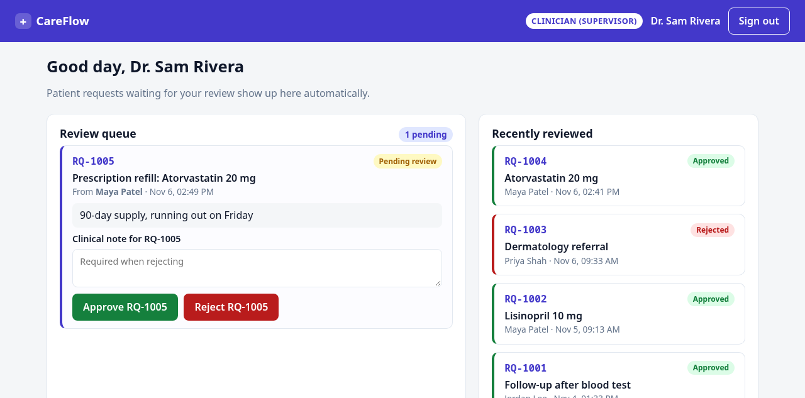
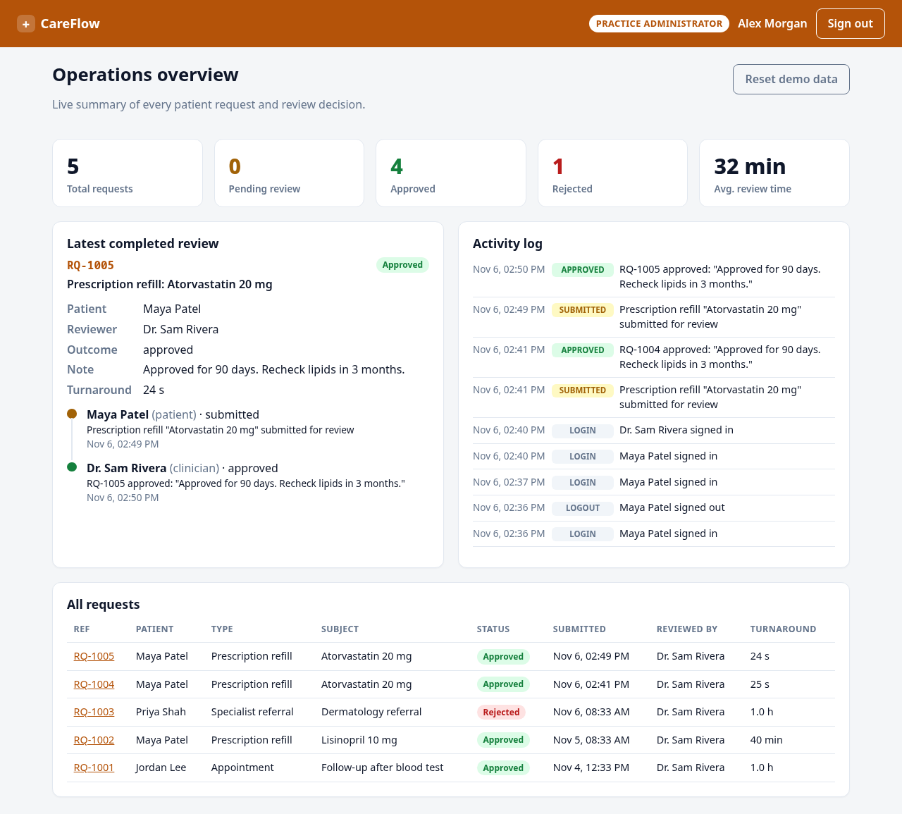

# CareFlow

**A mock healthcare app built as a practice target for AI browser agents.** It has three user roles,
each with its own dashboard, and one workflow that crosses all three. That makes it a good playground for
showing how to run **one browser agent per role** at the same time and check that they see each other's actions.

It was made for a live tutorial on multi-agent QA with [herdr](https://herdr.dev) (a terminal workspace for
coding agents) and [agent-browser](https://agent-browser.dev) (a browser-automation CLI for agents), driven by
[Claude Code](https://claude.com/claude-code). You can also use the app on its own as a target for any
end-to-end testing tool.

> [!WARNING]
> This is a **demo, not a medical product.** All people and data are fictional, passwords are hard-coded in
> plain text, and the "database" is a JSON file. Run it only on your own machine.

| Patient                                                                                                                  | Clinician (Supervisor)                                                                          | Admin                                                                                               |
| ------------------------------------------------------------------------------------------------------------------------ | ----------------------------------------------------------------------------------------------- | --------------------------------------------------------------------------------------------------- |
|  |  |  |

## The workflow

1. **Patient** (Maya Patel) submits a request: prescription refill, appointment or referral.
2. **Clinician** (Dr. Sam Rivera) sees it appear in their review queue within 2 seconds, then approves or rejects it with a note.
3. The **Patient** sees the decision and note on their dashboard, live.
4. **Admin** (Alex Morgan) sees KPIs, the latest completed review with its timeline, an activity log and every request.

Patients can open only their own requests. Opening another patient's request (for example `/requests/RQ-1001`) shows _Access denied_.

## Quick start: just the app

You need **Node.js 22 or later** and **pnpm** (`corepack enable` gives you pnpm).

```bash
git clone https://github.com/masterborn/careflow-demo.git
cd careflow-demo
pnpm install
pnpm dev          # → http://localhost:5173
```

Sign in with any of these accounts:

| Role                   | Email                         | Password              | Header colour |
| ---------------------- | ----------------------------- | --------------------- | ------------- |
| Patient                | `maya.patient@careflow.test`  | `patient-pass-2026`   | teal          |
| Clinician (Supervisor) | `sam.clinician@careflow.test` | `clinician-pass-2026` | indigo        |
| Admin                  | `alex.admin@careflow.test`    | `admin-pass-2026`     | amber         |

To try the cross-role flow by hand, open each role in a separate browser profile or private window.
Sessions are cookies, so one browser profile holds one signed-in user.

## The full demo: one AI agent per role

This is what the repo is really for. A Claude Code "orchestrator" uses herdr to open three terminal panes, starts a Claude
agent in each one, gives each agent a role, and walks them through a five-step scenario. Each agent drives its own
browser window with agent-browser and saves screenshots as evidence.

Extra prerequisites (with the versions the demo was recorded on):

| Tool                                                          | Tested version | What it does here                                                                 |
| ------------------------------------------------------------- | -------------- | --------------------------------------------------------------------------------- |
| [Claude Code](https://claude.com/claude-code)                 | 2.1            | The orchestrator and the three role agents                                        |
| [herdr](https://herdr.dev)                                    | 0.9.5          | Splits the terminal into one pane per agent and lets the orchestrator prompt them |
| [agent-browser](https://github.com/vercel-labs/agent-browser) | 0.41           | Gives each agent its own isolated, logged-in browser                              |
| Google Chrome                                                 | any recent     | The browser agent-browser drives                                                  |

The demo was run on Linux. A few guide commands, such as `google-chrome-stable --new-window`, differ on macOS and Windows.

**Follow [DEMO_GUIDE.md](DEMO_GUIDE.md).** It walks through:

1. Storing each role's credentials and login session once, by hand, so the agents never see a password.
2. Starting the orchestrator with [`prompts/orchestrator.md`](prompts/orchestrator.md).
3. What the audience should see at each step, and how to reset between runs.

## What makes it a good test target

- Every interactive element has an accessible name and a `data-testid`.
- Dashboards poll every 2 seconds, so a change made by one role shows up for the others without reloading.
- The API returns real `401`, `403`, `400` and `409` errors, so there are negative paths to test: a patient opening someone else's request, rejecting without a note, deciding a request twice.
- The clicked element gets a brief fuchsia ring, and a decided review card stays in the queue for 3 seconds, so viewers can follow fast agents.
- Data persists across restarts. **Reset demo data** on the admin dashboard restores the seed requests and keeps everyone signed in. `pnpm reset` wipes everything, logins included.

## How it works

There is no separate backend. The mock API is a Vite plugin, so `pnpm dev` serves the React app and the API on one port.
Because of that, **the app only works under `pnpm dev`**. `pnpm build` produces static files with no API behind them
and serves only as a type and bundle check.

| Method and path                                      | Who                           | What                                                                            |
| ---------------------------------------------------- | ----------------------------- | ------------------------------------------------------------------------------- |
| `POST /api/login`, `POST /api/logout`, `GET /api/me` | anyone                        | Cookie session (`HttpOnly`, stored in `data/db.json`)                           |
| `GET /api/requests`                                  | any role                      | Patients get their own requests; clinicians and admins get all of them          |
| `POST /api/requests`                                 | patient                       | Submit a request                                                                |
| `GET /api/requests/:id`                              | any role (patients: own only) | One request plus its history                                                    |
| `POST /api/requests/:id/decision`                    | clinician                     | `{ "decision": "approved" \| "rejected", "note": "…" }`. Rejecting needs a note |
| `GET /api/admin/summary`, `POST /api/admin/reset`    | admin                         | KPIs and activity log; reset the requests                                       |

## Repository layout

| Path                      | What                                                                                                   |
| ------------------------- | ------------------------------------------------------------------------------------------------------ |
| `server/api.ts`           | Mock API (Vite middleware): users, cookie sessions, role checks, seed data, JSON-file store            |
| `src/pages/`              | One dashboard per role (`PatientHome`, `ClinicianHome`, `AdminHome`), plus `Login` and `RequestDetail` |
| `src/components/`         | Shared layout (role-coloured header) and status badge                                                  |
| `prompts/orchestrator.md` | Prompt for the Claude Code session that drives herdr                                                   |
| `prompts/roles/*.md`      | Role brief given to each browser agent                                                                 |
| `prompts/scenario.md`     | The five-step cross-role test scenario                                                                 |
| `agent-browser.json`      | agent-browser project config: visible (headed) browser windows                                         |
| `DEMO_GUIDE.md`           | Step-by-step guide to running the multi-agent demo                                                     |
| `AGENTS.md`               | Orientation for coding agents working in this repo                                                     |

Created at runtime and git-ignored: `data/` (database and sessions), `screenshots/` (agent evidence) and `auth/` (optional exported browser state).

## Scripts

| Command          | What                                                                                          |
| ---------------- | --------------------------------------------------------------------------------------------- |
| `pnpm dev`       | App and API on http://localhost:5173. The port is fixed because the demo prompts depend on it |
| `pnpm build`     | Typecheck and production bundle (a check only, see above)                                     |
| `pnpm typecheck` | TypeScript only                                                                               |
| `pnpm reset`     | Delete `data/db.json`. The next request reseeds it, and every login session is gone           |
